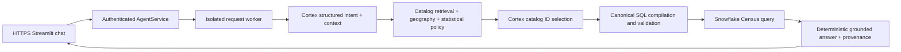

# Census Chat — Snowflake Census Analytics

**Live demo: https://census-104-248-239-52.sslip.io**

Open the HTTPS URL, enter the reviewer token supplied privately with the submission,
and start chatting. No installation or Snowflake account is required. Tokens belong
only in the password-style login field, never in a URL or Git. See
[reviewer instructions](docs/REVIEWER_ACCESS.md). Repository access and demo login
are separate; final delivery blockers are tracked in [the final audit](docs/FINAL_SUBMISSION_AUDIT.md).

Try:

> Using ACS release 2020, what is the total population of Autauga County, Alabama?

Expected recorded result: **55,639**. Follow up with **“And in 2019?”** (**55,380**).
Another supported example: “Using 2020 decennial redistricting data, how many people
live in Alabama?” (**5,024,279**). These examples are regression cases, not held-out tests.
Expand **Data provenance** for the metric, universe, source, release and physical field.
Use **New conversation** to reset or **Sign out** to clear the browser session.

## What it does

A conversational analytics application over the Snowflake Marketplace US Open Census
Neighborhood Insights dataset. Snowflake Cortex (`llama3.3-70b`) interprets intent
and selects verified metadata. Python generates and validates SQL, executes it through
the Snowflake Connector, and formats answers directly from returned numbers.
The model never supplies executable SQL or answer statistics.



The catalog preserves 73 object schemas and 59 statistical indicator tables for
2019/2020 ACS releases and 2020 decennial redistricting. It indexes all **16,582
supplied field definitions**; **296 undefined physical fields are quarantined**.
BM25 retrieval is local and dependency-free. CBG identifiers preserve leading zeros;
state/county resolution uses release-specific FIPS metadata. See
[architecture](docs/ARCHITECTURE.md) and [Phase 1 evidence](docs/PHASE1_REPORT.md).

## Correctness and security

- Structured conversation state inherits or changes metric, geography, release and
  comparisons; genuine ambiguity asks for clarification.
- Only verified additive counts aggregate across distinct CBGs within the same
  metric/product/release. Medians, ratios and MOEs cannot be summed; unsupported
  scopes refuse rather than substitute a related statistic.
- Typed query plans compile to quoted, allowlisted identifiers and bound values.
  Backend validation regenerates and compares the entire SQL, parameters and limits
  before connecting. There is no arbitrary SQL endpoint.
- Public requests pass through bearer authentication, owner-bound sessions, atomic
  SQLite admission and a fresh spawn-based process/connection. One active request,
  rate limits, durable Cortex-submission accounting and a 55-second request deadline
  bound resource use. Uncertain cleanup quarantines admission for operator review.
- The UI renders an explicit public-response allowlist, not private SQL, prompts,
  grant audits or raw exceptions. Deployment credentials come only from server secrets.

Production is one DigitalOcean host: nonroot Streamlit container, Caddy with trusted
HTTPS, private persistent SQLite volume and restart policies. Port 8501 is private.
Production uses `AGENT_PROD` / `APP_ROLE` with secondary roles disabled; local
`CODEX_APP` uses `DEV_WH`. **Strict least privilege remains incomplete:** PUBLIC
inherits a learning role with broader warehouse/schema rights. No privilege cleanup
has been silently applied. See [deployment permissions](docs/DEPLOYMENT_PERMISSIONS.md)
and [Phase 4 report](docs/PHASE4_REPORT.md).

## Setup and reproduction

Python 3.11; run from the repository root. Offline tests/search need no credentials.

```bash
python3 -m venv .venv
.venv/bin/python -m pip install -r requirements-dev.txt -r requirements-web.txt
.venv/bin/python -m census_catalog search "population" --year 2020 --top-k 3
bash scripts/doctor.sh
bash scripts/verify.sh
.venv/bin/python -m pip check
bash scripts/preflight.sh
```

Verification runs Ruff, Bash syntax checks and pytest. Live tests are opt-in and
are reported as **skipped**, not passed. Preflight exit 2 means incomplete delivery
items; exit 1 indicates failure/risk. ShellCheck is optional and currently unavailable.

For **local operator** live use only, create an owner-only `.env` using the variable
names in [.env.example](.env.example), with your own authorized Snowflake credentials
and development warehouse. Never use the production warehouse concurrently with the
demo. The CLI consumes Snowflake/Cortex credits:

```bash
.venv/bin/python -m census_agent
# /reset clears context; /quit exits. --question runs a single question.
# Opt-in real integration tests, only on the authorized development configuration:
.venv/bin/python -m pytest -q tests/test_phase1_live.py --snowflake-live
# Phase 2 separately: RUN_PHASE2_LIVE=1 .venv/bin/python -m pytest -q tests/phase2/test_live.py
```

The live suite is intentionally excluded from the default offline run; do not rerun
it casually against the reviewer's budget. Server deployment uses **no development
.env fallback**. Existing Docker configuration, secret setup, control-volume recovery
and optional browser tooling are documented in the [runbook](docs/DEPLOYMENT_RUNBOOK.md).
Do not copy secrets or runtime SQLite state into a checkout or image.

## Evaluation

- Phase 1: nine recorded real-data tests and full supplied-definition reconciliation.
- Phase 2: 16 real integration tests, six development questions across five metric
  families and three multi-turn scenarios, checked against independent reference SQL.
- Phase 3: first independent 25-case evaluation **19/25**; failures retained. After
  fixes, the same cases passed **25/25 as regression**, not new held-out accuracy.
- Phase 4: ten-point public acceptance, including session isolation, authentication,
  rate controls and persistence across restart. A later measured Alabama browser
  request took 12.9913s; paired profiled service runs improved 15.0294s to 13.6739s.
  Cortex timing also varied: these samples establish neither p95 nor an SLA.
- Final offline checks: **203 passed, 25 opt-in live tests skipped**. Historical
  HTTPS/two-turn evidence: [Phase 5 report](docs/PHASE5_REPORT.md).
  Final packaging, health and audit: [submission audit](docs/FINAL_SUBMISSION_AUDIT.md).

See [evaluation plan and preserved failures](docs/EVALUATION_PLAN.md),
[reflection](REFLECTION.md), and [requirement traceability](docs/CHALLENGE_SPEC.md).

Current reviewer limits: 1200 Cortex submission attempts per rolling 24h, 12 requests
per principal/minute, 60 global/minute, 256 sessions with 2h TTL. Local refusals do not
consume model units; submitted provider failures do. See [budget repair](docs/BUDGET_FIX_REPORT.md).

## Known limitations

Only captured releases/products and implemented state/county/explicit-CBG scopes are
supported; city/place resolution, historic boundary crosswalks, arbitrary joins,
nationwide coverage guarantees and non-additive spatial aggregation are not supported.
ACS labels are provider release years; exact survey intervals are unverified. Changes
between releases are not statistical-significance claims. Missing/suppressed or
invalid data fail safely. Schema drift requires a reviewed catalog refresh.

Single-host SQLite and one active warehouse lease favor safety over throughput.
Busy/rate/budget/quarantine responses may require waiting or operator recovery.
Login/history may reset after a browser reload or service restart. A shared finite
reviewer budget, temporary sslip.io DNS, Snowflake availability, password-based service
authentication and inherited privileges remain operational risks. More-time priorities
are in [REFLECTION.md](REFLECTION.md); no final email has been sent.
