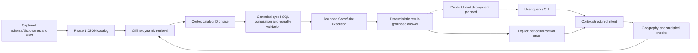

# Architecture

Status: Phase 1 catalog and Phase 2 core conversational agent implemented.
Official PDF reconciled; public UI/deployment remain planned outside Phase 2.
Requirement IDs are defined in CHALLENGE_SPEC.md; actual evaluation is recorded in PHASE2_REPORT.md.

## Overview
The reusable offline catalog supplies search, geography and statistical policy.
The core agent uses Cortex for structured intent and metadata choice, canonical
Python SQL compilation/validation, bounded connector execution and deterministic
answers from returned numbers. It reuses captured metadata without rediscovery.

Solid paths are implemented in Phase 1/2. Dashed UI/deployment paths are future work.
Cortex never supplies executable SQL or statistical answer numbers.

## Interfaces
| Component | Actual implementation/contract | Status / requirement |
| --- | --- | --- |
| Metadata capture | `scripts/collect_phase1_metadata.py`; INFORMATION_SCHEMA.COLUMNS, three field dictionaries, two FIPS dictionaries; query IDs and cleanup | Implemented; P1-1/P1-5 |
| Catalog builder | `build_catalog(snapshot, inventory, states)` reconciles exact IDs/types; detects duplicates/missing mappings; captures schemas, definitions, policy and gaps | Implemented; P1-1/P1-5 |
| Catalog artifact | `data/semantic_catalog.json`, format_version=1; all 73 object schemas, 59 indicator tables, 16,878 fields | Implemented; P1-1 |
| Retrieval | `Catalog.search(query, year, source_product, top_k, include_moe)` returns verified semantics plus exact physical schema context; `mapping`/`table_schema` expose identifiers | Implemented; P1-2 |
| Geography | `parse_cbg`; `Geography.resolve_state`, `resolve_county`, `lookup_cbg` using year-specific metadata | Implemented; P1-3 |
| Statistical policy | `classify`; `CountObservation`; `sum_counts` verifies field, release/product and distinct CBGs before summation | Implemented; P1-4 |
| CLI | `python -m census_catalog build/search/geography` reads captured artifacts; no remote inference | Implemented; P1-6 |
| Real-data boundary tests | `tests/test_phase1_live.py --snowflake-live`; existing authenticated connector; bounded selects/joins/sum | Implemented tests, not an agent executor |
| Core agent | `CensusAgent.ask` resolves typed intent, grounded catalog choice, canonical queries and deterministic answers; `Response` retains SQL/query IDs/provenance | Implemented; AS-1/AS-3/AS-4 |
| Conversation state | `ConversationState`: resolved/pending intent and chosen field; follow-up merge, clarification, comparison, reset; caller owns state | Implemented in memory; AS-2 |
| Runtime SQL validation | `compile_query` / `validate_query` regenerate a typed plan and compare exact SQL, params and row bounds; backend rechecks before connecting | Implemented; AS-4 |
| Agent CLI / transport | `python -m census_agent`; `SnowflakeBackend` wraps existing config loader, Cortex COMPLETE, permission audit and suspend | Implemented local interface; no web UI |
| UI / public hosting | Framework/platform and deployment process not selected; no public endpoint | Planned; AS-5 |

## Census statistical semantics
Every catalog entry retains exact table/column/type, metadata source, title/topic,
universe, field path, estimate/MOE classification, year and source family. ACS B/C
families are distinct from 2020 decennial redistricting. ACS year is a provider
release label; survey interval is null because supplied metadata does not prove it.
Do not present it as a single-year measurement or compare it blindly to decennial counts.

There are 16,582 supplied definitions. The other 296 physical fields are schema-known
but semantically undefined: recorded, excluded from search, non-aggregatable. All
supplied definitions and 59 indicator families are covered; universal semantic
coverage of every physical column is not claimed. Ancillary geometry/patterns and
two derived rental views retain schemas but lack cataloged indicator definitions.

Spatial summation is implemented only for verified additive counts with the same
field/year/product and distinct full CBGs. Medians, means/per-capita values, ratios,
indexes, MOEs, unclear units and aggregate amounts are unsupported. Duplicate joins,
missing/suppressed/negative/nonfinite values and numeric overflow are rejected.
Temporal/category aggregation, weighted means, ratio reconstruction, MOE propagation
and automatic nationwide coverage are not implemented. Some valid count distributions
with percentage-bearing titles are conservatively blocked.

## Geography and data flow
CBG keys are 12-digit strings; state = first 2 digits, county = next 3, tract = next
6 and block group = last digit. Leading zeros are preserved. Exact county names or
GEOIDs and an optional state disambiguate duplicate county names. State full names
come from the cited Census reference; counties/FIPS from each release's Snowflake
metadata. Provider null territory abbreviations remain identifiable as null.

The resolver validates a prefix's county association; it does not prove a CBG exists
in a source table. `cbg_membership_verified` stays false in the utility. Historical
real tests joined two Alabama CBGs in each of three product/release tables; those
results prove the sampled associations only. Cities/places, global key uniqueness,
join coverage, territory scope and boundary crosswalks remain unverified/unsupported.

## Cortex and Text-to-SQL flow
`planning.py` strictly parses nine intent slots: metric, statistic kind, year,
product, geographies, comparison, aggregation, filters and domain. Pending intent
lets clarification inherit the missing scope; resolved intent updates only on a
successful answer. A geography/year-only follow-up can reuse the selected field.
A new metric clears obsolete filters. A category-only follow-up can inherit an
established count when the model leaves the statistic unknown; generic income and
explicitly different statistics still clarify. Comparisons accept at most two distinct
geographies. Ambiguous pronouns after comparisons require clarification.

Retrieval searches the complete Phase 1 catalog, expands matched statistical-table
siblings, applies definition/universe/category constraints, then supplies up to 35
candidates to Cortex. Neither tables nor metric IDs are hardcoded in agent source.
Bounded candidate retrieval does not guarantee general recall. Cortex outputs only
a candidate ID or clarification; noncandidate identifiers are rejected.

`llama3.3-70b` is Phase 2's default, without changing the historical `.env` default.
At most two model calls per turn; temperature 0, max_tokens 450, Cortex guardrails.
There is no automatic model retry/fallback. Existing COMPLETE is reused; answers
are composed in Python from verified result rows, definitions, source/release and
geographic labels, not from unconstrained model narrative.

## Security boundaries
Application SQL has two canonical forms: a single-CBG published value or a bounded
state/county aggregate of an additive count. Identifiers come from `Catalog.mapping`;
values are bound parameters. A typed plan regenerates SQL, parameters and fetch
bounds at the executor boundary. Any changed statement, function, identifier,
parameter or bound fails closed before data execution. No general SQL parser or
arbitrary SQL endpoint is exposed. Trusted Cortex and permission/cleanup statements
are separate backend code paths, not user-selectable operations.

Queries check duplicate CBGs and null/negative/suppressed values; bad results do not
produce statistics or partial comparisons. Results are at most two point rows or
one aggregate row per geography. Data timeout is at most 15s, model 20s, queue 3s;
shared 50s request budget reserves cleanup. Network/login timeouts are finite.
Connector/network behavior is bounded but not a hard real-time service guarantee.
Each turn attempts suspend and verifies warehouse state; failed cleanup is visible.

The application uses primary role PUBLIC with secondary mode ALL. A live NONE
trial could not access the dataset; ALL restored the existing user-granted access.
Visible role/user grants and successful data operations are recorded. There are no
GRANT changes and no claim of complete account audit or least privilege. The current
user has broader privileges than the canonical application data surface.

Local credentials are ignored, owner-only and read only by the authorized existing
loader. No credentials enter Cortex prompts. Local request guards plus Cortex
intent/domain validation separate Census analytics from off-topic/inappropriate
requests; statistical race/sex analysis remains allowed. Error diagnostics are
sanitized, conversation state is explicit, and model trace history resets per turn.
The synchronous backend is not designed for concurrent shared sessions: callers
must use separate backends/states or serialize access. UI authentication, browser
credential isolation, hosted session lifecycle and rate limits remain future work.

## Design choices
Use standard-library compact JSON and in-memory inverted-index/BM25 retrieval.
No embeddings, vector database, inference expense or service dependency is required
for Phase 1. Separate metadata search, geography and aggregation to make policies
independently testable. Catalog scores rank lexical matches; they are not calibrated
confidence and are not statistical correctness guarantees.

## Failure modes
| Trigger | Current behavior / remaining action |
| --- | --- |
| Undefined field / altered case / schema drift | Quarantine/no search result or exact-schema error; future remote schema freshness checks planned |
| Unsupported year / ambiguous county / invalid CBG | Geography raises explicit errors; search returns empty for unavailable years or errors on a conflicting year; agent returns clarification |
| Unsupported or mixed statistic / duplicate CBG | Explicit aggregation denial; agent returns safe refusal |
| Empty/unrelated query | Empty search result; no fabricated mapping |
| Connector/model outage | Agent returns sanitized error, preserves successful context and attempts cleanup; zero automatic retries |
| Broad geography / unknown survey interval | No inferred national total/cross-year compatibility; constrain scope or request evidence |

## Alternatives
JSON + lexical scoring was chosen over SQLite FTS5 (unneeded binary/index artifact
at current scale) and embeddings/vector infrastructure (extra cost, dependencies
and nondeterminism). Recorded load/index cost is 3.617s; five single local searches
were 2.746–58.391ms, not a service latency SLA. A future index change requires a
measured need. Full decision rationale and accepted/proposed distinction are in
DECISIONS.md. Evidence and planned tests are in EVALUATION_PLAN.md.
