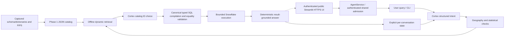
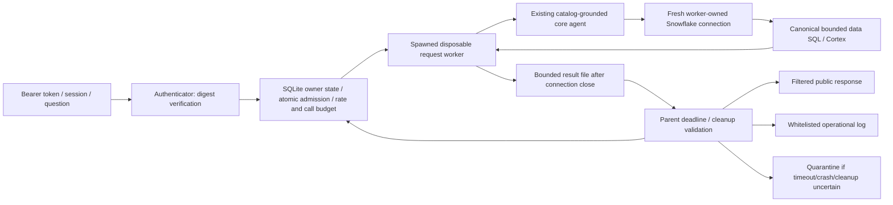

# Architecture

Status: Phase 1/2 preserved; Phase 3 reliability service implemented and verified within Phase 3 scope.
Official PDF reconciled. Phase 4 Streamlit HTTPS frontend is deployed and verified;
authenticated Census acceptance is externally verified, with inherited-permission
cleanup and final delivery work still outstanding.
Requirement IDs are defined in CHALLENGE_SPEC.md; historical/current evidence is in PHASE2_REPORT.md and PHASE3_REPORT.md.

## Overview
The reusable offline catalog supplies search, geography and statistical policy.
The core agent uses Cortex for structured intent and metadata choice, canonical
Python SQL compilation/validation, bounded connector execution and deterministic
answers from returned numbers. It reuses captured metadata without rediscovery.

Core paths are implemented in Phase 1/2 and hardened in Phase 3. The UI calls AgentService. Public HTTPS authentication, Census answers, follow-up, isolation, rate control and
post-restart data access are externally verified.
Cortex never supplies executable SQL or statistical answer numbers.

## Interfaces
| Component | Actual implementation/contract | Status / requirement |
| --- | --- | --- |
| Metadata capture | `scripts/collect_phase1_metadata.py`; INFORMATION_SCHEMA.COLUMNS, three field dictionaries, two FIPS dictionaries; query IDs and cleanup | Implemented; P1-1/P1-5 |
| Catalog builder | `build_catalog(snapshot, inventory, states)` reconciles exact IDs/types; detects duplicates/missing mappings; captures schemas, definitions, policy and gaps | Implemented; P1-1/P1-5 |
| Catalog artifact | `data/semantic_catalog.json`, format_version=1; all 73 object schemas, 59 indicator tables, 16,878 fields | Implemented; P1-1 |
| Retrieval | `Catalog.search(query, year, source_product, top_k, include_moe)` returns verified semantics plus exact physical schema context; `mapping`/`table_schema` expose identifiers | Implemented; P1-2 |
| Geography | `parse_cbg`; `Geography.resolve_state`, `resolve_county`, `lookup_cbg` using year-specific metadata | Implemented; P1-3 |
| Statistical policy | `classify`; `CountObservation`; `sum_counts` verifies field, release/product and distinct CBGs before summation | Implemented; P1-4 |
| CLI | `python -m census_catalog build/search/geography` reads captured artifacts; no remote inference | Implemented; P1-6 |
| Real-data boundary tests | `tests/test_phase1_live.py --snowflake-live`; existing authenticated connector; bounded selects/joins/sum | Implemented tests, not an agent executor |
| Core agent | `CensusAgent.ask` resolves typed intent, grounded catalog choice, canonical queries and deterministic answers; `Response` retains SQL/query IDs/provenance | Implemented; AS-1/AS-3/AS-4 |
| Conversation state | `ConversationState`: resolved/pending intent and chosen field; follow-up merge, clarification, comparison, reset; caller owns state | Core memory state plus authenticated service SQLite persistence; AS-2 |
| Runtime SQL validation | `compile_query` / `validate_query` regenerate a typed plan and compare exact SQL, params and row bounds; backend rechecks before connecting | Implemented; AS-4 |
| Agent CLI / transport | `python -m census_agent`; `SnowflakeBackend` wraps existing config loader, Cortex COMPLETE, permission audit and suspend | Implemented local operator interface; Web adapter below |
| UI / public hosting | Streamlit public-response adapter, Docker/Caddy single-instance configuration and external smoke runner; live public HTTPS endpoint with authenticated reviewer access | Externally verified; permission residual documented; AS-5/AS-17 |

## Census statistical semantics
Every catalog entry retains exact table/column/type, metadata source, title/topic,
universe, field path, estimate/MOE classification, year and source family. ACS B/C
families are distinct from 2020 decennial redistricting. ACS year is a provider
release label; survey interval is null because supplied metadata does not prove it.
Do not present it as a single-year measurement or compare it blindly to decennial counts.

There are 16,582 supplied definitions. The other 296 physical fields are schema-known
but semantically undefined: recorded, excluded from search, non-aggregatable. All
supplied definitions and 59 indicator families are covered; universal semantic
coverage of every physical column is not claimed. Ancillary geometry/patterns and
two derived rental views retain schemas but lack cataloged indicator definitions.

Spatial summation is implemented only for verified additive counts with the same
field/year/product and distinct full CBGs. Medians, means/per-capita values, ratios,
indexes, MOEs, unclear units and aggregate amounts are unsupported. Duplicate joins,
missing/suppressed/negative/nonfinite values and numeric overflow are rejected.
Temporal/category aggregation, weighted means, ratio reconstruction, MOE propagation
and automatic nationwide coverage are not implemented. Some valid count distributions
with percentage-bearing titles are conservatively blocked.

## Geography and data flow
CBG keys are 12-digit strings; state = first 2 digits, county = next 3, tract = next
6 and block group = last digit. Leading zeros are preserved. Exact county names or
GEOIDs and an optional state disambiguate duplicate county names. State full names
come from the cited Census reference; counties/FIPS from each release's Snowflake
metadata. Provider null territory abbreviations remain identifiable as null.

The resolver validates a prefix's county association; it does not prove a CBG exists
in a source table. `cbg_membership_verified` stays false in the utility. Historical
real tests joined two Alabama CBGs in each of three product/release tables; those
results prove the sampled associations only. Cities/places, global key uniqueness,
join coverage, territory scope and boundary crosswalks remain unverified/unsupported.

## Cortex and Text-to-SQL flow
`planning.py` strictly parses nine intent slots: metric, statistic kind, year,
product, geographies, comparison, aggregation, filters and domain. Pending intent
lets clarification inherit the missing scope; resolved intent updates only on a
successful answer. A geography/year-only follow-up can reuse the selected field.
A new metric clears obsolete filters. A category-only follow-up can inherit an
established count when the model leaves the statistic unknown; generic income and
explicitly different statistics still clarify. Comparisons accept at most two distinct
geographies. Ambiguous pronouns after comparisons require clarification.

Retrieval searches the complete Phase 1 catalog, expands matched statistical-table
siblings, applies definition/universe/category constraints, then supplies up to 35
candidates to Cortex. Neither tables nor metric IDs are hardcoded in agent source.
Bounded candidate retrieval does not guarantee general recall. Cortex outputs only
a candidate ID or clarification; noncandidate identifiers are rejected.

`llama3.3-70b` is Phase 2's default, without changing the historical `.env` default.
At most two model calls per turn; temperature 0, max_tokens 450, Cortex guardrails.
There is no automatic model retry/fallback. Existing COMPLETE is reused; answers
are composed in Python from verified result rows, definitions, source/release and
geographic labels, not from unconstrained model narrative.

## Security boundaries
Application SQL has two canonical forms: a single-CBG published value or a bounded
state/county aggregate of an additive count. Identifiers come from `Catalog.mapping`;
values are bound parameters. A typed plan regenerates SQL, parameters and fetch
bounds at the executor boundary. Any changed statement, function, identifier,
parameter or bound fails closed before data execution. No general SQL parser or
arbitrary SQL endpoint is exposed. Trusted Cortex and permission/cleanup statements
are separate backend code paths, not user-selectable operations.

Queries check duplicate CBGs and null/negative/suppressed values; bad results do not
produce statistics or partial comparisons. Results are at most two point rows or
one aggregate row per geography. Data timeout is at most 15s, model 20s, queue 3s;
shared 50s request budget reserves cleanup. Network/login timeouts are finite.
Connector/network behavior is bounded but not a hard real-time service guarantee.
Each turn attempts suspend and verifies warehouse state; failed cleanup is visible.

The application uses primary role PUBLIC with secondary mode ALL. A live NONE
trial could not access the dataset; ALL restored the existing user-granted access.
Visible role/user grants and successful data operations are recorded. There are no
GRANT changes and no claim of complete account audit or least privilege. The current
user has broader privileges than the canonical application data surface.

Local credentials are ignored, owner-only and read only by the authorized existing
loader. No credentials enter Cortex prompts. Local request guards plus Cortex
intent/domain validation separate Census analytics from off-topic/inappropriate
requests; statistical race/sex analysis remains allowed. Error diagnostics are
sanitized, conversation state is explicit, and model trace history resets per turn.
The low-level backend now enforces process/thread ownership and core agent/state
locks reject overlapping use. Public deployment must call AgentService: isolated
request workers own fresh connections, authenticated state and shared budgets.
Streamlit UI and TLS proxy configuration are implemented in Phase 4; actual public hosting and multi-host control remain unavailable.

## Design choices
Use standard-library compact JSON and in-memory inverted-index/BM25 retrieval.
No embeddings, vector database, inference expense or service dependency is required
for Phase 1. Separate metadata search, geography and aggregation to make policies
independently testable. Catalog scores rank lexical matches; they are not calibrated
confidence and are not statistical correctness guarantees.

## Failure modes
| Trigger | Current behavior / remaining action |
| --- | --- |
| Undefined field / altered case / schema drift | Quarantine/no search result or exact-schema error; future remote schema freshness checks planned |
| Unsupported year / ambiguous county / invalid CBG | Geography raises explicit errors; search returns empty for unavailable years or errors on a conflicting year; agent returns clarification |
| Unsupported or mixed statistic / duplicate CBG | Explicit aggregation denial; agent returns safe refusal |
| Empty/unrelated query | Empty search result; no fabricated mapping |
| Connector/model outage | Agent returns sanitized error, preserves successful context and attempts cleanup; zero automatic retries |
| Broad geography / unknown survey interval | No inferred national total/cross-year compatibility; constrain scope or request evidence |

## Alternatives
JSON + lexical scoring was chosen over SQLite FTS5 (unneeded binary/index artifact
at current scale) and embeddings/vector infrastructure (extra cost, dependencies
and nondeterminism). Recorded load/index cost is 3.617s; five single local searches
were 2.746–58.391ms, not a service latency SLA. A future index change requires a
measured need. Full decision rationale and accepted/proposed distinction are in
DECISIONS.md. Evidence and planned tests are in EVALUATION_PLAN.md.

## Phase 3 deployment boundary (implemented, no UI)

`AgentService.create_session/ask/reset` authenticate ownership internally. Session
IDs are random and bound to a verified principal; callers cannot supply another
user's state. Parent receives validated typed state only after worker completion.
The SQLite store opens a short transaction/connection per operation; no database
cursor/connection or conversation object is shared between simultaneous requests.
Core overlap/reset locks and backend process/thread guards also protect direct use.

SQLiteControl atomically permits one active warehouse request across all local
service processes. This deliberately serializes the trial warehouse: a per-request
ALTER SUSPEND must not interrupt another service worker. Overload is immediate,
with no unbounded queue. All workers must share the same local owner-only control
file and limits (mismatched configurations fail). Session TTL/capacity, per-principal
and global sliding-window rates, and a shared 24h model-call reserve are implemented.
Each admitted request reserves two call units conservatively without refund. This
bounds application inference calls, not measured credits/dollars. There are no new
dependencies/services. SQLite rollback journaling is used; deployment requires local
storage with correct locking. Multi-host/pod stores are explicitly unsupported today.

Default parent budget is 55s, including authentication, admission, worker startup,
catalog load, connection/audit, inference, SQL, cleanup and result transfer. Worker
soft deadline reserves eight seconds for cleanup. Parent joins only to its deadline,
terminates/kills a nonresponsive worker and joins with bounded waits. Completed
worker results are read from a bounded owner-only temporary file after exit, avoiding
an indefinitely blocked partial pipe read. OS/filesystem behavior is not a real-time
guarantee. A timeout suppresses results and committed state; server queries may
outlive client termination, so admission quarantines rather than auto-resumes.

Recovery is a trusted operator-only method, never an AgentService/public method.
An operator must independently verify warehouse suspension AND no active server
queries before `recover_after_operator_check`; it cannot clear a live lease. Losing
an expired lease also fails closed. Normal completed requests preserve resolved or
pending state, close connections and confirm suspension. CLI/reference probes
bypass admission and must not run alongside a deployed service on the same warehouse.

`Response.public_dict` omits raw SQL, intent, model output, errors, permission
snapshots and configuration. Trusted diagnostics retain selected mappings/SQL/query
IDs for evaluation. Logs contain only request UUID, status, elapsed seconds and worker
health, never user question, token, session ID or connector exception text. Server
adapters must return `ServiceResult.public`, not its operator diagnostics or
`Response.as_dict`. Bearer tokens must be cryptographically random, supplied through
server-held digests and transported over TLS; no real demo tokens were created or
committed in this phase. Authentication/revocation/TLS hosting remain deployment work.

Primary role and secondary mode are trusted constructor options for a future
restricted identity. Working PUBLIC/ALL access is preserved. Fresh visible grants
include up to four inherited roles and CURRENT_SESSION identity; lack of grant
visibility is not proof of absence. Dedicated read-only identity/role migration and
review of broad PUBLIC baseline need administrator action; see DEPLOYMENT_PERMISSIONS.md.
No grants, warehouse provisioning or credential configuration changed here.

Semantic hardening preserves canonical SQL. Literal household counts cannot become
household income; missing product for a new 2020 population question cannot be chosen
by the model; geography/year-only follow-ups preserve the established metric.
Retrieval uses original wording plus planned phrases. Verified tenure universes and
exact poverty cell labels are supported without guessing physical IDs or relaxing
bachelor-only/category/numeric boundary checks. First independent failures and
subsequent regression outcomes remain separately recorded.

## Phase 4 Web adapter and hosting boundary

Implemented: `web_app.py` -> `census_web.app` -> shared immutable AgentService facade.
Streamlit WebSocket session holds only its own token/session/history; SQLite owns
structured context, admission and budgets. Login/new conversation/ask/reset all go
through authenticated service methods. Service resources are cached, conversation
objects and connector sessions are not. History is capped at 40 messages; questions
are bounded to 2,000 characters. Busy input is disabled and fast reruns off.

UI displays plain-text answers, status, latency and allowlisted catalog provenance
(release/source/universe/field/aggregation). It never renders `diagnostics`, raw SQL,
model prompts, errors or permission snapshots. Loading status provides progress.
Tokens are user-entered password widgets, cleared on form submission, retained only
in that server-side Streamlit session and cleared on logout. Digests live only in
server config. Reload/reconnect can require login; no browser resume capability.

`census_web.runtime` requires a reviewed nonadmin primary role, dedicated identity,
secondary NONE, private durable control, public HTTPS origin and explicit confirmations
of storage/exclusive warehouse/permission review. Explicit AGENT_PROD password mode
reads server environment only; optional legacy key-pair mode validates a private key.
These are configuration checks/attestations, not proof of effective least privilege.
Backend receives complete connection_config; local CLI retains its separate .env loader.

Actual topology: one nonroot Python container plus Caddy on the existing approved
DigitalOcean host, public 80/443 only, persistent private local SQLite, server env and
restart policies. Sites/ephemeral multi-host alternatives were rejected for the retained
Python spawn/local-file model; no paid alternative provisioned. Real public browser and
post-SSH/restart data checks pass; see current PHASE4_REPORT.md. No multi-host claim.

## Historical checkpoint — initial DigitalOcean physical deployment
The user selected the existing Droplet 104.248.239.52. One Docker app (UID 10001) and
one Caddy proxy now run, with existing SQLite volume/process-isolation architecture.
Trusted HTTPS and externally closed 8501 are measured, as are restart/volume continuity
for the control probe. Per-container memory/CPU/PID and log rotation bounds are set.
No Agent/catalog/Web Python functionality changed. Service source is 08e5bfb with
checkpointed Compose hardening; exact image hashes are in phase4_recovery/host_status.json.
The frontend at https://census-104-248-239-52.sslip.io deliberately fails closed while
admin flags remain false. Restricted identity/PUBLIC review and actual data/auth E2E
are still blocked. Physical hosting is implemented; full application readiness is not.

## Historical checkpoint — v0.4.2 production authentication update
The Web runtime injects a complete server-environment connection_config into each
isolated worker. Explicit password mode is restricted to AGENT_PROD; CODEX_APP,
missing credentials, mixed key/password configuration and PUBLIC/admin primary roles
fail closed. No development .env fallback is reachable through this adapter. Existing
local CLI configuration remains unchanged. Legacy key-pair mode is available via an
optional Compose override; the default password deployment mounts no private key.
The reviewer auth, session ownership, durable SQLite, worker/deadline/SQL boundaries
are unchanged. Production identity connectivity is verified, but named-role/NONE and
PUBLIC review/exclusive-warehouse prerequisites still block public Census activation.

## Phase 4 activation — APP_ROLE and existing deployment
Server configuration now selects AGENT_PROD/APP_ROLE/secondary NONE; reviewed gates
are enabled after operator authorization and real role/NONE checks. Local development
CODEX_APP uses DEV_WH. All requests continue through AgentService, immutable facade,
per-request spawn worker/connection and the SAME private SQLite admission database.
No core architectural/statistical changes. Final external suite passes; exact sessions,
states and quota events persist across controlled restart. Fresh login/new UI chat may
be needed after reconnect; automatic browser conversation resumption is not claimed.

Residual trust boundary: PUBLIC still inherits SNOWFLAKE_LEARNING_ROLE with production
warehouse privileges and learning DB CREATE SCHEMA. APP_ROLE's cleanup depends on that
inherited OPERATE. An exclusive operational warehouse assignment is not privilege
isolation. Administrator should grant APP_ROLE explicit OPERATE, then review PUBLIC
inheritance without losing developer access. No grants/revokes are executed here.
Default PUBLIC CORTEX_USER remains separately accepted. See PHASE4_REPORT.md.

## Phase 4 performance follow-up — immutable derived metadata index
Docker build generates data/semantic_search_index.jsonl (manifest + JSON payload).
Manifest binds exact catalog bytes, implementation bytes and payload bytes. Workers
retain schema/type/verification validation and load identical precomputed BM25
postings; no statistical result or credential caching. Invalid/missing artifacts
fall back to the original catalog constructor. Each spawned worker retains its own
catalog/connection/state; no new process pool or shared database connection.

Backend close skips only a duplicate suspension already confirmed on that connection.
Any SQL attempt or new connection invalidates the flag; failure/quarantine rules stay
unchanged. Current release latency-20261014 preserves the same SQLite volume and
operational limits. See PHASE4_LATENCY.md for modest measured gain and remaining costs.

## Phase 5 packaging boundary
No application architecture changed. README/Reflection and final submission audit
now describe the actual deployed system. Fresh external two-turn regression passed;
original Phase 1–4 evidence is retained. Repository privacy/reviewer access, absolute
submission metadata, credit visibility and the inherited-permission residual remain
open in PHASE5_REPORT.md. Documentation packaging does not restart production or
change its persistent control database/secrets.
